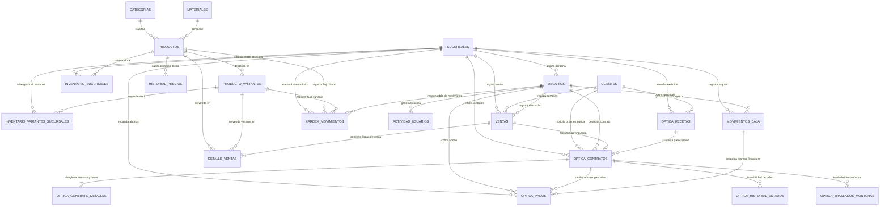

# CAPÍTULO V. DISEÑO TÉCNICO

---

## 5.1 Tecnologías Propuestas

El diseño técnico y la arquitectura del sistema **Joyería & Óptica Mariné POS** han sido concebidos bajo un enfoque modular, escalable, de alto rendimiento y bajo acoplamiento. Se ha seleccionado una arquitectura orientada a servicios ligeros (*Lightweight Service-Oriented Architecture*) con una aplicación cliente de página única (*Single Page Application* - SPA) empaquetada de manera híbrida nativa para dispositivos móviles Android y terminales de punto de venta táctiles, comunicada con un backend API RESTful y sincronización en tiempo real mediante WebSockets.

A continuación, se desglosa el stack tecnológico seleccionado, justificando su implementación técnica:

```
┌────────────────────────────────────────────────────────────────────────┐
│                        ARQUITECTURA TECNOLÓGICA                        │
└────────────────────────────────────────────────────────────────────────┘
  [ CLIENTE / FRONTEND ]                [ SERVIDOR / BACKEND ]
  - Vanilla JS ES6+ (Modular SPA)       - Node.js (v20+ LTS / v24)
  - HTML5 Semántico + CSS3 Variables     - Express.js (v4.18.2 Core API)
  - Capacitor 6/8 Android Native Bridge - Socket.io (v4.7.4 Realtime)
  - Google ML Kit Barcode Scanner        - JWT (jsonwebtoken v9.0.2)
  - ESC/POS Thermal Printer Plugin       - BcryptJS (v2.4.3 Salting)
  - JsBarcode & SheetJS (xlsx)          - PDFKit (v0.19.1 Vector Engine)
             │                                     │
             └─────────────── HTTPS / WSS ─────────┘
                                   │
                         [ BASE DE DATOS CLOUD ]
                         - PostgreSQL 16 (Neon Serverless)
                         - Pool de Conexiones pg (v8.11.3)
                         - Cifrado TLS 1.3 / SSL Mode Require
                         - Transacciones ACID Concurrencia
```

---

### 5.1.1 Lenguajes de Programación

1. **JavaScript (ECMAScript 2022+ / ES6+):**
   - **Backend:** Empleado sobre el entorno de ejecución Node.js utilizando arquitectura modular CommonJS (`require`/`module.exports`), funciones asíncronas nativas (`async`/`await`), y manipulación de flujos de datos (*streams* y *buffers*) para la generación de comprobantes binarios y reportes.
   - **Frontend:** Implementado mediante Vanilla JavaScript estructurado en módulos nativos ES (`import`/`export`), evitando sobrecargas de frameworks pesados para garantizar tiempos de respuesta inferiores a 16 ms (60 FPS estables) en terminales de bajo consumo de memoria RAM (dispositivos Android POS de 2GB/3GB).
2. **SQL Estándar ANSI / PL/pgSQL:**
   - Lenguaje de manipulación y definición de datos ejecutado en el motor relacional PostgreSQL. Se emplean bloques anónimos PL/pgSQL, secuencias correlativas transaccionales, índices compuestos B-Tree y consultas analíticas agregadas (CTE - *Common Table Expressions* y Funciones de Ventana).
3. **Java / Kotlin (Capa Nativa Móvil):**
   - Lenguaje base del contenedor nativo de Android en el directorio `android/`, utilizado por el puente de Capacitor para gestionar el ciclo de vida de la actividad principal (`MainActivity`), permisos de hardware (cámara, Bluetooth, almacenamiento) y renderizado sobre el componente `android.webkit.WebView`.

---

### 5.1.2 Frameworks y Bibliotecas

#### A. Capa de Backend (Servidor)
* **Express.js (v4.18.2):** Framework web minimalista que gestiona el enrutamiento RESTful, canalización de peticiones (*middleware pipeline*), parseo de cargas JSON y multipart, y centralización del manejo de excepciones HTTP.
* **Socket.IO (v4.7.4):** Motor de comunicación bidireccional y basada en eventos sobre WebSockets. Empleado para la propagación reactiva de eventos críticos de inventario (`stock:changed`, `venta:registrada`, `caja:actualizada`), permitiendo que terminales distribuidas sincronicen sus existencias de inmediato tras una venta.
* **pg (node-postgres v8.11.3):** Cliente oficial de PostgreSQL para Node.js con soporte de pool de conexiones (`Pool`), reconexión elástica y ejecución obligatoria de sentencias preparadas y parametrizadas para inmunidad frente a inyecciones SQL.
* **jsonwebtoken (v9.0.2):** Implementación de tokens JWT estándar RFC 7519 para la gestión de sesiones sin estado (*stateless session management*), firma criptográfica HMAC-SHA256 (`HS256`) y verificación de expiración temporal.
* **bcryptjs (v2.4.3):** Biblioteca criptográfica de derivación de claves que aplica la función hash adaptativa Blowfish con 10 rondas de salteo (*salt rounds*), protegiendo las credenciales frente a ataques de fuerza bruta y tablas arcoíris.
* **pdfkit (v0.19.1):** Motor vectorial para la generación programática en el servidor de órdenes de trabajo de óptica en formato A4, recetas y comprobantes de alta definición, generando flujos binarios directamente hacia el cliente HTTP.
* **xlsx (SheetJS v0.18.5) & csv-parse (v5.5.3):** Motor de procesamiento bidireccional de hojas de cálculo para la importación masiva de catálogos y la exportación de libros de Kárdex Físico y balances de inventario.
* **multer (v1.4.5-lts.1):** Middleware para el procesamiento seguro de cargas de archivos en peticiones `multipart/form-data` (imágenes de catálogo, logotipos y firmas de recetas).
* **cors (v2.8.5):** Control estricto de orígenes de recursos cruzados, asegurando que solo dominios autorizados y esquemas nativos (`capacitor://localhost`) puedan consumir los servicios de la API.
* **dotenv (v16.4.1):** Gestión hermética de variables de entorno desacopladas del código fuente.

#### B. Capa de Frontend y Cliente Móvil
* **Capacitor Framework (v6.x / v8.x CLI & Core):** Runtime multiplataforma desarrollado por Ionic que encapsula la aplicación web en un contenedor nativo Android de alto rendimiento, exponiendo APIs nativas mediante plugins de bajo nivel.
* **@capacitor-mlkit/barcode-scanning (v8.1.0):** Integración nativa del kit de visión artificial de Google (*Google ML Kit*), permitiendo el procesamiento en hardware de la cámara del dispositivo móvil para decodificar códigos de barras 1D (Code 128, EAN-13, UPC) y 2D (QR Code) en milisegundos sin requerir conexión a internet.
* **@bcyesil/capacitor-plugin-printer (v0.0.6):** Plugin nativo de Android que canaliza trabajos de impresión directa hacia el servicio de spooler y controladores de impresoras térmicas ESC/POS conectadas mediante Bluetooth, USB o red local.
* **html5-qrcode (v2.3.8):** Motor de escaneo por cámara complementario para entornos de navegador de escritorio que cuentan con cámaras web estándar.
* **JsBarcode (v3.12.3):** Generador de códigos de barras vectoriales dinámicos en Canvas y SVG para la vista de rotulado e impresión de etiquetas físicas de joyas y monturas.
* **Chart.js (v4.5.1):** Biblioteca de renderizado gráfico basada en Canvas HTML5 para visualización de métricas analíticas comerciales, rentabilidad por categoría y comparativas de caja.

---

### 5.1.3 Base de Datos

* **Motor:** **PostgreSQL 16 Enterprise-grade Relational Database**.
* **Infraestructura Cloud:** Alojado sobre **Neon Serverless PostgreSQL** (Región AWS `us-east-1`).
* **Características Clave de la Base de Datos:**
  - **Arquitectura Serverless:** Separación estricta entre capacidad de cómputo (*compute*) y almacenamiento distribuido (*storage*), permitiendo escalado automático de recursos ante picos transaccionales.
  - **Soporte ACID Completo:** Aislamiento transaccional estricto con control de concurrencia multiversión (MVCC), garantizando atomicidad mediante bloqueos a nivel de registro (`SELECT ... FOR UPDATE`) en transferencias de stock, ventas y registros de abonos.
  - **Conectividad Cifrada:** Canal seguro obligatorio mediante TLS 1.3 con soporte de certificados digitales (`sslmode=require`).
  - **Respaldo Continuo (PITR):** Capacidad de recuperación punto en el tiempo (*Point-in-Time Recovery*) y réplicas de solo lectura para la emisión de reportes pesados y vistas de Business Intelligence.

---

### 5.1.4 Herramientas de Desarrollo y Servicios

* **Entorno de Desarrollo Integrado (IDE):** Visual Studio Code (con extensiones de linting ESLint, PostgreSQL Client y depuradores de Node.js) y Android Studio Iguana/Jellyfish para la compilación, firmado y depuración del bundle APK/AAB nativo.
* **Gestor de Dependencias y Tareas:** Node Package Manager (`npm`).
* **Control de Versiones y Flujo CI/CD:** Git alojado en GitHub. Cuenta con despliegue continuo (*Continuous Deployment*) configurado para compilar y desplegar automáticamente en el entorno de producción al detectar cambios validados en la rama `main`.
* **Plataforma de Despliegue Backend (PaaS):** **Render Web Services**, ejecutando una instancia de contenedor Linux administrada con reinicios automáticos, monitoreo de salud (*Health Checks* en `/api/health`), certificados SSL Let's Encrypt aprovisionados de forma dinámica y balanceo de carga HTTPS.

---

## 5.2 Diseño de Base de Datos

El modelo de datos relacional de la solución ha sido normalizado hasta la Tercera Forma Normal (3FN), garantizando la no redundancia de atributos y preservando la integridad referencial mediante claves foráneas con reglas de eliminación y actualización explícitas (`ON DELETE CASCADE`, `ON DELETE SET NULL`, `ON DELETE RESTRICT`).

A continuación se presenta el **Diagrama Entidad-Relación Lógico Completo** en notación estándar Mermaid:



---

### 5.2.1 Diccionario de Datos del Sistema

A continuación, se documenta la estructura pormenorizada de las tablas que componen el núcleo transaccional, operativo y analítico de la solución:

#### 1. Tabla: `sucursales` (Entidades de Distribución Física)
| Columna | Tipo de Dato | Modificadores / Restricciones | Descripción |
| :--- | :--- | :--- | :--- |
| `id` | `SERIAL` | `PRIMARY KEY` | Identificador único de la tienda o sede física. |
| `nombre` | `TEXT` | `NOT NULL` | Razón comercial de la sucursal (ej. 'Tienda Principal', 'Sede Óptica'). |
| `direccion` | `TEXT` | `DEFAULT ''` | Dirección física de ubicación comercial. |
| `telefono` | `TEXT` | `DEFAULT ''` | Teléfono de contacto de la sucursal. |
| `activo` | `BOOLEAN` | `DEFAULT TRUE` | Estado operacional de la sucursal. |
| `created_at` | `TIMESTAMPTZ` | `DEFAULT NOW()` | Fecha y hora de creación de la sede. |

#### 2. Tabla: `usuarios` (Control de Cuentas y Operadores)
| Columna | Tipo de Dato | Modificadores / Restricciones | Descripción |
| :--- | :--- | :--- | :--- |
| `id` | `SERIAL` | `PRIMARY KEY` | Identificador único del usuario. |
| `nombre` | `TEXT` | `NOT NULL` | Nombre completo del colaborador o empleado. |
| `username` | `TEXT` | `NOT NULL UNIQUE` | Nombre de usuario para autenticación en el sistema. |
| `password_hash` | `TEXT` | `NOT NULL` | Contraseña cifrada mediante algoritmo Blowfish (Bcrypt). |
| `rol` | `TEXT` | `DEFAULT 'cajero'` | Rol en el sistema: `'admin'` (acceso total) o `'cajero'` (operativo). |
| `sucursal_id` | `INTEGER` | `REFERENCES sucursales(id) ON DELETE SET NULL` | Sede asignada habitualmente al usuario. |
| `activo` | `BOOLEAN` | `DEFAULT TRUE` | Estado de acceso del usuario al aplicativo. |
| `created_at` | `TIMESTAMPTZ` | `DEFAULT NOW()` | Fecha de registro del usuario en la base de datos. |

#### 3. Tablas de Catálogo Base: `categorias` y `materiales`
- `categorias`: (`id` PK, `nombre` TEXT UNIQUE NOT NULL, `activo` BOOLEAN, `created_at` TIMESTAMPTZ). Agrupa artículos (ej. Anillos, Aretes, Monturas Oftálmicas, Lentes de Sol).
- `materiales`: (`id` PK, `nombre` TEXT UNIQUE NOT NULL, `activo` BOOLEAN, `created_at` TIMESTAMPTZ). Define composición (ej. Oro 18k, Plata 925, Titanio, Acetato, Policarbonato).

#### 4. Tabla: `productos` (Catálogo Maestro de Artículos)
| Columna | Tipo de Dato | Modificadores / Restricciones | Descripción |
| :--- | :--- | :--- | :--- |
| `id` | `SERIAL` | `PRIMARY KEY` | Identificador único del producto. |
| `codigo` | `TEXT` | `UNIQUE` | Código de barras o SKU principal del artículo. |
| `nombre` | `TEXT` | `NOT NULL` | Denominación comercial del producto. |
| `descripcion` | `TEXT` | `DEFAULT ''` | Detalles específicos de fabricación o diseño. |
| `categoria_id` | `INTEGER` | `REFERENCES categorias(id) ON DELETE SET NULL` | Clave foránea hacia la categoría asignada. |
| `material_id` | `INTEGER` | `REFERENCES materiales(id) ON DELETE SET NULL` | Clave foránea hacia el material base. |
| `peso_gramos` | `NUMERIC(10,2)`| `DEFAULT 0` | Peso neto en gramos (clave para joyería fina). |
| `precio_compra` | `NUMERIC(10,2)`| `DEFAULT 0` | Costo de adquisición o manufactura unitario. |
| `precio_venta` | `NUMERIC(10,2)`| `NOT NULL` | Precio de venta oficial al público (S/.). |
| `stock_actual` | `INTEGER` | `DEFAULT 0` | Existencia global sumaria calculada. |
| `stock_minimo` | `INTEGER` | `DEFAULT 1` | Umbral crítico para alertas visuales de reabastecimiento. |
| `tiene_variantes`| `BOOLEAN` | `DEFAULT FALSE` | Indica si el producto desglosa en tallas/medidas/colores. |
| `descuento_porcentaje`| `NUMERIC(5,2)`| `DEFAULT 0` | Descuento promocional autorizado por defecto. |
| `imagen_path` | `TEXT` | `NULLABLE` | Ruta o URL de la fotografía del producto. |
| `activo` | `BOOLEAN` | `DEFAULT TRUE` | Disponibilidad para venta y catálogo. |
| `created_at` | `TIMESTAMPTZ` | `DEFAULT NOW()` | Marca de tiempo de registro. |
| `updated_at` | `TIMESTAMPTZ` | `DEFAULT NOW()` | Última actualización de metadatos o costo. |

#### 5. Tabla: `producto_variantes` (Especificaciones por Talla, Color o Medida)
| Columna | Tipo de Dato | Modificadores / Restricciones | Descripción |
| :--- | :--- | :--- | :--- |
| `id` | `SERIAL` | `PRIMARY KEY` | Identificador único de la variante. |
| `producto_id` | `INTEGER` | `NOT NULL REFERENCES productos(id) ON DELETE CASCADE` | Producto padre al que pertenece la variante. |
| `sku` | `TEXT` | `UNIQUE NOT NULL` | Código de barras único de la variante (impreso en etiqueta). |
| `nombre_variante` | `TEXT` | `NOT NULL` | Nombre descriptivo (ej. 'Talla 7 - Oro Amarillo'). |
| `atributo_1_nombre`| `TEXT` | `DEFAULT ''` | Atributo principal (ej. 'Talla', 'Calibre', 'Graduación'). |
| `atributo_1_valor` | `TEXT` | `DEFAULT ''` | Valor principal (ej. '14', '52-18', '+1.50'). |
| `atributo_2_nombre`| `TEXT` | `DEFAULT ''` | Atributo secundario (ej. 'Color', 'Acabado'). |
| `atributo_2_valor` | `TEXT` | `DEFAULT ''` | Valor secundario (ej. 'Dorado', 'Carey'). |
| `precio_venta` | `NUMERIC(10,2)`| `NULLABLE` | Precio diferenciado (o hereda del producto si es nulo). |
| `stock_actual` | `INTEGER` | `DEFAULT 0` | Suma de existencias de la variante. |
| `activo` | `BOOLEAN` | `DEFAULT TRUE` | Estado operativo de la variante. |

#### 6. Tablas de Existencia Multi-Sucursal: `inventario_sucursales` e `inventario_variantes_sucursales`
- `inventario_sucursales`: Gestiona el stock localizado de productos simples (`id` PK, `sucursal_id` FK, `producto_id` FK, `stock_actual` INT, `stock_minimo` INT, `stock_original` INT, `UNIQUE(sucursal_id, producto_id)`).
- `inventario_variantes_sucursales`: Gestiona el stock localizado por variante (`id` PK, `sucursal_id` FK, `variante_id` FK, `stock_actual` INT, `stock_minimo` INT, `stock_original` INT, `UNIQUE(sucursal_id, variante_id)`).

#### 7. Tabla: `clientes` (Registro de Compradores y Pacientes)
| Columna | Tipo de Dato | Modificadores / Restricciones | Descripción |
| :--- | :--- | :--- | :--- |
| `id` | `SERIAL` | `PRIMARY KEY` | Identificador único del cliente/paciente. |
| `nombre` | `TEXT` | `NOT NULL` | Nombres y apellidos completos o Razón Social. |
| `tipo_documento` | `TEXT` | `DEFAULT 'DNI'` | Documento de identidad ('DNI', 'RUC', 'CE', 'PASAPORTE'). |
| `dni_ruc` | `TEXT` | `DEFAULT ''` | Número del documento de identidad. |
| `telefono` | `TEXT` | `DEFAULT ''` | Teléfono o número de WhatsApp para notificaciones de entrega. |
| `email` | `TEXT` | `DEFAULT ''` | Correo electrónico de facturación o contacto. |
| `direccion` | `TEXT` | `DEFAULT ''` | Domicilio legal o fiscal del cliente. |
| `fecha_nacimiento` | `DATE` | `NULLABLE` | Fecha de nacimiento para cálculo cronológico. |
| `edad` | `INTEGER` | `NULLABLE` | Edad calculada para perfiles de presbicia y atención óptica. |
| `created_at` | `TIMESTAMPTZ` | `DEFAULT NOW()` | Fecha de registro inicial. |

#### 8. Tabla: `ventas` (Cabecera de Comprobante y Transacciones)
| Columna | Tipo de Dato | Modificadores / Restricciones | Descripción |
| :--- | :--- | :--- | :--- |
| `id` | `SERIAL` | `PRIMARY KEY` | Identificador único de la transacción de venta. |
| `numero_comprobante` | `TEXT` | `UNIQUE` | Serie y correlativo (ej. 'B001-000452', 'F001-000120'). |
| `tipo_comprobante` | `TEXT` | `DEFAULT 'boleta'` | Tipo fiscal: `'boleta'`, `'factura'`, `'ticket'`. |
| `sucursal_id` | `INTEGER` | `REFERENCES sucursales(id) ON DELETE SET NULL` | Sede en la que se despachó y cobró la venta. |
| `cliente_id` | `INTEGER` | `REFERENCES clientes(id) ON DELETE SET NULL` | Receptor de la venta. |
| `usuario_id` | `INTEGER` | `REFERENCES usuarios(id) ON DELETE SET NULL` | Vendedor o cajero que procesó el cobro. |
| `subtotal` | `NUMERIC(10,2)`| `NOT NULL` | Base imponible o suma previa a descuentos. |
| `descuento` | `NUMERIC(10,2)`| `DEFAULT 0` | Descuento total aplicado a la venta. |
| `total` | `NUMERIC(10,2)`| `NOT NULL` | Monto final neto liquidado en moneda nacional (S/.). |
| `metodo_pago` | `TEXT` | `DEFAULT 'efectivo'` | Medio de pago: `'efectivo'`, `'yape'`, `'tarjeta'`, `'mixto'`. |
| `monto_efectivo` | `NUMERIC(10,2)`| `NULLABLE` | En pago cruzado/mixto: porción saldada en efectivo. |
| `monto_yape` | `NUMERIC(10,2)`| `NULLABLE` | En pago cruzado/mixto: porción saldada vía billetera digital. |
| `monto_pagado` | `NUMERIC(10,2)`| `DEFAULT 0` | Efectivo entregado físicamente por el comprador. |
| `cambio` | `NUMERIC(10,2)`| `DEFAULT 0` | Vuelto entregado al cliente. |
| `estado` | `TEXT` | `DEFAULT 'completada'` | Estado: `'completada'`, `'anulada'`. |
| `motivo_anulacion` | `TEXT` | `NULLABLE` | Sustento auditado en caso de revocación de la venta. |
| `fecha` | `TIMESTAMPTZ` | `DEFAULT NOW()` | Marca temporal de la transacción. |

#### 9. Tabla: `detalle_ventas` (Líneas de Comprobante)
| Columna | Tipo de Dato | Modificadores / Restricciones | Descripción |
| :--- | :--- | :--- | :--- |
| `id` | `SERIAL` | `PRIMARY KEY` | Identificador de línea. |
| `venta_id` | `INTEGER` | `NOT NULL REFERENCES ventas(id) ON DELETE CASCADE` | Transacción de venta asociada. |
| `producto_id` | `INTEGER` | `NOT NULL REFERENCES productos(id)` | Producto base vendido. |
| `variante_id` | `INTEGER` | `REFERENCES producto_variantes(id)` | Variante específica vendida (si aplica). |
| `cantidad` | `INTEGER` | `NOT NULL` | Unidades físicas transferidas. |
| `precio_unitario` | `NUMERIC(10,2)`| `NOT NULL` | Precio de venta pactado por unidad al momento de la venta. |
| `descuento_item` | `NUMERIC(10,2)`| `DEFAULT 0` | Rebaja sobre la línea. |
| `subtotal_item` | `NUMERIC(10,2)`| `NOT NULL` | Total neto de la línea (`cantidad * precio - descuento`). |

#### 10. Tabla: `movimientos_caja` (Flujo de Caja Chica y Arqueo)
| Columna | Tipo de Dato | Modificadores / Restricciones | Descripción |
| :--- | :--- | :--- | :--- |
| `id` | `SERIAL` | `PRIMARY KEY` | Identificador del movimiento de tesorería. |
| `sucursal_id` | `INTEGER` | `REFERENCES sucursales(id) ON DELETE SET NULL` | Sede del flujo de caja. |
| `usuario_id` | `INTEGER` | `NOT NULL REFERENCES usuarios(id)` | Responsable de la apertura, ingreso o retiro. |
| `tipo` | `TEXT` | `NOT NULL CHECK(tipo IN ('ingreso', 'egreso'))`| Dirección del flujo financiero. |
| `concepto` | `TEXT` | `NOT NULL` | Motivo ('APERTURA DE CAJA', 'VENTA DIRECTA', 'ABONO OPTICA', 'GASTO OPERATIVO'). |
| `monto` | `NUMERIC(10,2)`| `NOT NULL` | Valor monetario del flujo. |
| `notas` | `TEXT` | `DEFAULT ''` | Observaciones o número de comprobante vinculado. |
| `fecha` | `TIMESTAMPTZ` | `DEFAULT NOW()` | Momento exacto del asiento contable. |

#### 11. Módulo de Óptica: `optica_recetas` (Prescripciones Oftálmicas)
| Columna | Tipo de Dato | Modificadores / Restricciones | Descripción |
| :--- | :--- | :--- | :--- |
| `id` | `SERIAL` | `PRIMARY KEY` | Identificador de la receta. |
| `cliente_id` | `INTEGER` | `NOT NULL REFERENCES clientes(id) ON DELETE CASCADE` | Paciente evaluado. |
| `sucursal_id` | `INTEGER` | `NOT NULL REFERENCES sucursales(id)` | Sede de la refracción. |
| `optometrista_id` | `INTEGER` | `REFERENCES usuarios(id)` | Profesional a cargo del diagnóstico. |
| `od_esfera` | `NUMERIC(5,2)`| `NULLABLE` | Esfera Ojo Derecho (Lejos). |
| `od_cilindro` | `NUMERIC(5,2)`| `NULLABLE` | Cilindro Ojo Derecho. |
| `od_eje` | `INTEGER` | `NULLABLE` | Grados de orientación del eje (0° a 180°). |
| `od_dp` | `NUMERIC(4,1)`| `NULLABLE` | Distancia pupilar Ojo Derecho (mm). |
| `oi_esfera` | `NUMERIC(5,2)`| `NULLABLE` | Esfera Ojo Izquierdo (Lejos). |
| `oi_cilindro` | `NUMERIC(5,2)`| `NULLABLE` | Cilindro Ojo Izquierdo. |
| `oi_eje` | `INTEGER` | `NULLABLE` | Grados de orientación del eje Ojo Izquierdo. |
| `oi_dp` | `NUMERIC(4,1)`| `NULLABLE` | Distancia pupilar Ojo Izquierdo (mm). |
| `od_adicion` | `NUMERIC(5,2)`| `NULLABLE` | Adición para presbicia Ojo Derecho (ADD). |
| `oi_adicion` | `NUMERIC(5,2)`| `NULLABLE` | Adición para presbicia Ojo Izquierdo (ADD). |
| `od_esfera_cerca` | `NUMERIC(5,2)`| `NULLABLE` | Esfera calculada para cerca (`od_esfera + od_adicion`). |
| `oi_esfera_cerca` | `NUMERIC(5,2)`| `NULLABLE` | Esfera calculada para cerca (`oi_esfera + oi_adicion`). |
| `tipo_luna` | `TEXT` | `NULLABLE` | `'monofocal'`, `'bifocal'`, `'progresivo'`, etc. |
| `material_luna` | `TEXT` | `NULLABLE` | `'resina_cr39'`, `'policarbonato'`, `'alto_indice'`, etc. |
| `tratamientos` | `TEXT` | `NULLABLE` | Lista delimitada por comas (`'antirreflejo,fotocromatico,uv400'`). |

#### 12. Módulo de Óptica: `optica_contratos` (Órdenes de Trabajo y Venta Asistida)
| Columna | Tipo de Dato | Modificadores / Restricciones | Descripción |
| :--- | :--- | :--- | :--- |
| `id` | `SERIAL` | `PRIMARY KEY` | Identificador único de orden de trabajo. |
| `codigo_contrato` | `TEXT` | `UNIQUE NOT NULL` | Código comercial (ej. `'OPT-260001'`). |
| `cliente_id` | `INTEGER` | `NOT NULL REFERENCES clientes(id)` | Titular del pedido. |
| `receta_id` | `INTEGER` | `REFERENCES optica_recetas(id) ON DELETE SET NULL` | Receta oftálmica aplicada. |
| `sucursal_id` | `INTEGER` | `NOT NULL REFERENCES sucursales(id)` | Sede de emisión. |
| `usuario_id` | `INTEGER` | `NOT NULL REFERENCES usuarios(id)` | Vendedor/asesor responsable. |
| `tipo_servicio` | `TEXT` | `NOT NULL` | `'completo'`, `'cambio_montura'`, `'reparacion'`, `'medicion'`. |
| `montura_tipo` | `TEXT` | `DEFAULT 'inventario_local'` | Origen: `'inventario_local'`, `'inventario_traslado'`, `'propia_cliente'`. |
| `montura_producto_id`| `INTEGER` | `REFERENCES productos(id) ON DELETE SET NULL` | Producto reservado para la montura. |
| `montura_variante_id`| `INTEGER` | `REFERENCES producto_variantes(id) ON DELETE SET NULL` | Variante de montura reservada. |
| `fecha_contrato` | `TIMESTAMPTZ` | `DEFAULT NOW()` | Fecha y hora de suscripción. |
| `fecha_estimada_entrega`| `TIMESTAMPTZ`| `NULLABLE` | Compromiso de entrega pactado con el paciente. |
| `estado` | `TEXT` | `DEFAULT 'registrado'` | `'registrado'`, `'en_elaboracion'`, `'listo_entrega'`, `'entregado'`, `'cancelado'`. |
| `subtotal` | `NUMERIC(10,2)`| `DEFAULT 0` | Costo consolidado de lunas + montura + servicios. |
| `descuento` | `NUMERIC(10,2)`| `DEFAULT 0` | Bonificación o rebaja acordada. |
| `total` | `NUMERIC(10,2)`| `DEFAULT 0` | Precio pactado final del contrato. |
| `total_pagado` | `NUMERIC(10,2)`| `DEFAULT 0` | Saldo acumulado por cobro de abonos. |
| `saldo_pendiente`| `NUMERIC(10,2)`| `DEFAULT 0` | Deuda pendiente de cobro contra entrega (`total - total_pagado`). |
| `estado_pago` | `TEXT` | `DEFAULT 'pendiente'` | `'pendiente'`, `'parcial'`, `'cancelado'`. |
| `venta_id` | `INTEGER` | `REFERENCES ventas(id) ON DELETE SET NULL` | Comprobante fiscal final emitido contra entrega. |

#### 13. Módulo de Óptica: `optica_contrato_detalles` y `optica_pagos`
- `optica_contrato_detalles`: Desglose tipo carrito del contrato (`id` PK, `contrato_id` FK, `tipo_item` TEXT, `producto_id` FK, `variante_id` FK, `descripcion` TEXT, `cantidad` INT, `precio_unitario` NUMERIC, `subtotal_item` NUMERIC).
- `optica_pagos`: Historial de amortizaciones/abonos (`id` PK, `contrato_id` FK, `monto` NUMERIC, `metodo_pago` TEXT, `monto_efectivo` NUMERIC, `monto_yape` NUMERIC, `usuario_id` FK, `sucursal_id` FK, `caja_movimiento_id` FK, `fecha` TIMESTAMPTZ).
- `optica_traslados_monturas`: Control logístico inter-sucursal (`id` PK, `contrato_id` FK, `producto_id` FK, `variante_id` FK, `sucursal_origen_id` FK, `sucursal_destino_id` FK, `estado` TEXT, `fecha_solicitud` TIMESTAMPTZ, `fecha_recepcion` TIMESTAMPTZ).
- `optica_historial_estados`: Auditoría de tiempos de ciclo (`id` PK, `contrato_id` FK, `estado_anterior` TEXT, `estado_nuevo` TEXT, `usuario_id` FK, `fecha` TIMESTAMPTZ).

#### 14. Tabla: `kardex_movimientos` (Kárdex Físico Operativo Permanente)
| Columna | Tipo de Dato | Modificadores / Restricciones | Descripción |
| :--- | :--- | :--- | :--- |
| `id` | `SERIAL` | `PRIMARY KEY` | Identificador del movimiento de inventario. |
| `producto_id` | `INTEGER` | `NOT NULL REFERENCES productos(id) ON DELETE CASCADE` | Producto trazado. |
| `variante_id` | `INTEGER` | `REFERENCES producto_variantes(id) ON DELETE CASCADE` | Variante trazada (si aplica). |
| `sucursal_id` | `INTEGER` | `NOT NULL REFERENCES sucursales(id)` | Almacén físico donde ocurre el cambio de saldo. |
| `usuario_id` | `INTEGER` | `REFERENCES usuarios(id)` | Responsable operativo de la acción. |
| `fecha` | `TIMESTAMPTZ` | `DEFAULT NOW()` | Fecha y hora cronológica del suceso. |
| `tipo_movimiento` | `TEXT` | `NOT NULL` | Tipo de movimiento: `'INVENTARIO_INICIAL'`, `'VENTA'`, `'ANULACION_VENTA'`, `'AJUSTE_POSITIVO'`, `'AJUSTE_NEGATIVO'`, `'OPTICA_RESERVA'`, `'OPTICA_CANCELACION'`, `'TRASLADO_SALIDA'`, `'TRASLADO_ENTRADA'`. |
| `tipo_documento` | `TEXT` | `NULLABLE` | Sustento legal: `'BOLETA'`, `'FACTURA'`, `'NOTA_VENTA'`, `'CONTRATO_OPTICA'`, `'GUIA_TRASLADO'`, `'CONTEO_FISICO'`. |
| `documento_referencia`| `TEXT` | `NULLABLE` | Folio de sustento (ej. `'B001-000452'`, `'OPT-260001'`). |
| `cantidad_entrada` | `INTEGER` | `DEFAULT 0` | Unidades físicas ingresadas al stock. |
| `cantidad_salida` | `INTEGER` | `DEFAULT 0` | Unidades físicas descontadas del stock. |
| `stock_anterior` | `INTEGER` | `DEFAULT 0` | Existencia física exacta previa a la transacción. |
| `stock_saldo` | `INTEGER` | `DEFAULT 0` | Existencia física resultante tras la transacción. |
| `motivo` | `TEXT` | `NULLABLE` | Explicación técnica del movimiento. |
| `notas` | `TEXT` | `NULLABLE` | Metadatos adicionales (cliente, destino, etc.). |
| `created_at` | `TIMESTAMPTZ` | `DEFAULT NOW()` | Marca de auditoría de inserción inmutable. |

*Índices de Aceleración B-Tree en Kárdex:*
- `idx_kardex_prod` (`producto_id`, `fecha DESC`)
- `idx_kardex_var` (`variante_id`, `fecha DESC`)
- `idx_kardex_sucursal` (`sucursal_id`)
- `idx_kardex_fecha` (`fecha DESC`)

---

## 5.3 Diseño de API

La arquitectura de la interfaz de programación de aplicaciones (API) del sistema está construida bajo los principios arquitectónicos **REST (Representational State Transfer)**, empleando HTTP sobre TLS (HTTPS) y formateo de cargas exclusivamente en **JSON (JavaScript Object Notation)** con codificación de caracteres `UTF-8`.

### 5.3.1 Matriz General de Endpoints del Sistema

| Módulo Funcional | Método | Ruta Relativa (`/api/...`) | Rol Mínimo | Descripción |
| :--- | :--- | :--- | :--- | :--- |
| **Autenticación** | `POST` | `/auth/login` | Público | Autentica credenciales y emite token JWT firmado. |
| **Autenticación** | `GET` | `/auth/me` | Cajero / Admin | Valida la vigencia del token y extrae perfil y permisos. |
| **Sucursales** | `GET` | `/sucursales` | Cajero / Admin | Lista todas las sucursales físicas activas. |
| **Sucursales** | `POST` | `/sucursales` | Administrador | Registra una nueva sucursal y aprovisiona inventarios. |
| **Productos** | `GET` | `/productos` | Cajero / Admin | Catálogo general con stock por sucursal y filtros. |
| **Productos** | `GET` | `/productos/sku/:sku` | Cajero / Admin | Búsqueda ultrarrápida por código para terminales de escaneo. |
| **Productos** | `POST` | `/productos` | Administrador | Creación de producto con control de duplicidad. |
| **Productos** | `PUT` | `/productos/:id` | Administrador | Edición de precios, catálogo, peso y atributos. |
| **Productos** | `DELETE`| `/productos/:id` | Administrador | Desactivación lógica (baja) de artículo. |
| **Variantes** | `GET` | `/variantes/producto/:id` | Cajero / Admin | Consulta de variantes asociadas a un producto padre. |
| **Variantes** | `PUT` | `/variantes/:id` | Administrador | Modificación de precio y stock de variante específica. |
| **Inventario** | `POST` | `/inventario/actualizar` | Cajero / Admin | Actualización operativa rápida de existencias. |
| **Ventas (POS)** | `POST` | `/ventas` | Cajero / Admin | Procesamiento atómico de carrito, cobro y descuento de stock. |
| **Ventas (POS)** | `POST` | `/ventas/:id/anular` | Administrador | Reversión transaccional completa con reposición de inventario. |
| **Ventas (POS)** | `GET` | `/ventas/:id/ticket` | Cajero / Admin | Generación de plantilla de impresión para ticketera térmica. |
| **Caja** | `GET` | `/caja/resumen` | Cajero / Admin | Arqueo actual: saldo en efectivo, Yape, ingresos y egresos. |
| **Caja** | `POST` | `/caja/movimiento` | Cajero / Admin | Asiento manual de apertura, inyección de fondos o gastos. |
| **Clientes** | `GET` | `/clientes` | Cajero / Admin | Búsqueda por DNI, RUC o nombre completo. |
| **Clientes** | `POST` | `/clientes` | Cajero / Admin | Alta de cliente con validación de tipo de documento y edad. |
| **Óptica** | `POST` | `/optica/recetas` | Cajero / Admin | Registro clínico de prescripción visual y refracción. |
| **Óptica** | `POST` | `/optica/contratos` | Cajero / Admin | Creación de contrato con reserva física de montura. |
| **Óptica** | `POST` | `/optica/contratos/:id/pagos` | Cajero / Admin | Registro de abono monetario y conciliación con caja. |
| **Óptica** | `PUT` | `/optica/contratos/:id/estado`| Cajero / Admin | Transición de estado en taller y entrega al paciente. |
| **Óptica** | `GET` | `/optica/contratos/:id/pdf-orden`| Cajero / Admin | Generación vectorial de orden de trabajo A4 (PDFKit). |
| **Óptica** | `GET` | `/optica/contratos/:id/ticket-resumen`| Cajero / Admin | Generación de comprobante térmico para ticketera. |
| **Kárdex** | `GET` | `/kardex/producto/:id` | **Administrador** | Historial cronológico de movimientos y saldos físicos. |
| **Kárdex** | `GET` | `/kardex/exportar` | **Administrador** | Descarga del libro de Kárdex consolidado en formato Excel. |
| **Kárdex** | `POST` | `/kardex/ajuste` | **Administrador** | Asiento manual de ajuste físico por conteo o merma. |
| **Auditoría** | `GET` | `/actividad` | **Administrador** | Bitácora cronológica inmutable de acciones en el sistema. |

---

### 5.3.2 Especificación Detallada de Endpoints Críticos

#### 1. Autenticación de Usuario (`POST /api/auth/login`)
- **Descripción:** Valida credenciales corporativas, genera token JWT firmado con el rol correspondiente y retorna los parámetros de la sucursal de trabajo.
- **Cabeceras:** `Content-Type: application/json`
- **Petición (Request Body):**
```json
{
  "username": "admin",
  "password": "Password123!"
}
```
- **Respuesta Exitosa (`200 OK`):**
```json
{
  "success": true,
  "token": "eyJhbGciOiJIUzI1NiIsInR5cCI6IkpXVCJ9.eyJpZCI6MSwidXNlcm5hbWUiOiJhZG1pbiIsInJvbCI6ImFkbWluIiwic3VjdXJzYWxfaWQiOjEsImlhdCI6MTc2MzA5NDAwMCwiZXhwIjoxNzYzMTIyNDAwfQ.k9J...",
  "usuario": {
    "id": 1,
    "nombre": "Administrador General",
    "username": "admin",
    "rol": "admin",
    "sucursal_id": 1,
    "sucursal_nombre": "Tienda Principal"
  }
}
```
- **Respuestas de Error:**
  - `400 Bad Request`: Payload incompleto (`{ "error": "Usuario y contraseña requeridos" }`).
  - `401 Unauthorized`: Credenciales inválidas o cuenta deshabilitada (`{ "error": "Credenciales incorrectas o usuario inactivo" }`).

---

#### 2. Procesamiento Transaccional de Venta (`POST /api/ventas`)
- **Descripción:** Ejecuta una transacción ACID que valida stock disponible, registra la venta, desglosa los ítems, decrementa existencias de forma atómica en la sucursal activa, asienta el ingreso en el arqueo de caja y genera los registros en el Kárdex Físico.
- **Cabeceras:** `Authorization: Bearer <JWT>`, `Content-Type: application/json`
- **Petición (Request Body):**
```json
{
  "cliente_id": 12,
  "tipo_comprobante": "boleta",
  "metodo_pago": "mixto",
  "monto_efectivo": 100.00,
  "monto_yape": 150.00,
  "descuento": 10.00,
  "sucursal_id": 1,
  "items": [
    {
      "producto_id": 45,
      "variante_id": 88,
      "cantidad": 1,
      "precio_unitario": 260.00,
      "descuento_item": 10.00
    }
  ]
}
```
- **Respuesta Exitosa (`201 Created`):**
```json
{
  "success": true,
  "venta_id": 789,
  "numero_comprobante": "B001-000452",
  "total": 250.00,
  "mensaje": "Venta procesada con éxito y stock actualizado"
}
```
- **Respuestas de Error:**
  - `400 Bad Request`: Stock insuficiente en la sucursal seleccionada (`{ "error": "Stock insuficiente para el producto 'Anillo Oro 18k'. Disponible: 0" }`).
  - `500 Internal Server Error`: Falla transaccional con reversión (`ROLLBACK`) automática.

---

#### 3. Emisión de Contrato de Óptica (`POST /api/optica/contratos`)
- **Descripción:** Registra una nueva orden de servicio de óptica vinculando al cliente y su prescripción oftálmica, calculando el cronograma de pago y reservando físicamente la montura seleccionada.
- **Cabeceras:** `Authorization: Bearer <JWT>`, `Content-Type: application/json`
- **Petición (Request Body):**
```json
{
  "cliente_id": 15,
  "receta_id": 8,
  "sucursal_id": 1,
  "tipo_servicio": "completo",
  "montura_tipo": "inventario_local",
  "montura_producto_id": 102,
  "montura_variante_id": null,
  "fecha_estimada_entrega": "2026-11-20T18:00:00Z",
  "subtotal": 350.00,
  "descuento": 30.00,
  "total": 320.00,
  "abono_inicial": 100.00,
  "metodo_pago_abono": "yape",
  "items": [
    {
      "tipo_item": "montura",
      "producto_id": 102,
      "descripcion": "Montura Acetato Carey Ray-Ban",
      "cantidad": 1,
      "precio_unitario": 180.00
    },
    {
      "tipo_item": "lunas",
      "descripcion": "Lunas Resina con Filtro Azul y Antirreflejo",
      "cantidad": 1,
      "precio_unitario": 140.00
    }
  ]
}
```
- **Respuesta Exitosa (`201 Created`):**
```json
{
  "success": true,
  "contrato_id": 42,
  "codigo_contrato": "OPT-260042",
  "total": 320.00,
  "total_pagado": 100.00,
  "saldo_pendiente": 220.00,
  "estado": "registrado",
  "mensaje": "Contrato creado y montura reservada satisfactoriamente"
}
```

---

#### 4. Consulta de Kárdex Físico Operativo (`GET /api/kardex/producto/:id`)
- **Descripción:** Retorna el libro de movimientos cronológicos de entradas, salidas y saldos físicos de un artículo o variante específica. **Ruta restringida exclusivamente al Rol Administrador.**
- **Cabeceras:** `Authorization: Bearer <JWT>`
- **Parámetros Query:** `?variante_id=88&sucursal_id=1&desde=2026-01-01&hasta=2026-11-30`
- **Respuesta Exitosa (`200 OK`):**
```json
{
  "success": true,
  "producto": {
    "id": 45,
    "nombre": "Anillo Compromiso Diamante",
    "codigo": "JOY-ANI-001"
  },
  "sucursal_id": 1,
  "stock_actual": 4,
  "movimientos": [
    {
      "id": 1205,
      "fecha": "2026-11-13T20:15:00.000Z",
      "tipo_movimiento": "VENTA",
      "tipo_documento": "BOLETA",
      "documento_referencia": "B001-000452",
      "cantidad_entrada": 0,
      "cantidad_salida": 1,
      "stock_anterior": 5,
      "stock_saldo": 4,
      "motivo": "Venta en Punto de Venta",
      "usuario_nombre": "Carlos Mendoza"
    }
  ]
}
```
- **Respuesta de Error por Permiso:**
  - `403 Forbidden`: Acceso denegado a operadores sin perfil de administrador (`{ "error": "Acceso restringido. Se requiere rol de Administrador." }`).

---

## 5.4 Seguridad

La arquitectura de seguridad del sistema implementa el principio de **Defensa en Profundidad (*Defense in Depth*)**, estructurando barreras de protección en la capa de transporte, capa de aplicación, capa de control de acceso y capa de persistencia de datos.

```
┌────────────────────────────────────────────────────────────────────────┐
│                   CAPAS DE SEGURIDAD DEL SISTEMA                       │
└────────────────────────────────────────────────────────────────────────┘
 [ TRANSPORTE ]   ──> Cifrado TLS 1.3 / HTTPS Obligatorio en Render & Neon
        │
 [ APLICACIÓN ]   ──> Middleware Auth JWT (Firma HMAC-SHA256, 8h vigencia)
        │
 [ AUTORIZACIÓN]  ──> Control de Acceso Basado en Roles (RBAC: Admin vs Cajero)
        │
 [ PERSISTENCIA ] ──> Parametrización Estricta SQL (Anti SQL Injection)
        │
 [ CRIPTOGRAFÍA]  ──> Hashing Adaptativo Blowfish (Bcrypt Salt Rounds = 10)
```

---

### 5.4.1 Autenticación

1. **Gestión de Sesiones sin Estado (Stateless JWT):**
   - El sistema prescinde de sesiones tradicionales en memoria del servidor o almacenamiento distribuido de sesiones en Redis, utilizando JSON Web Tokens (JWT) portados en la cabecera estándar `Authorization: Bearer <token>`.
   - **Algoritmo Criptográfico:** HMAC con SHA-256 (`HS256`), sustentado en una clave secreta pseudoaleatoria de alta entropía (`JWT_SECRET`) configurada en el servidor.
   - **Ventana de Expiración:** Los tokens emitidos cuentan con una vida útil programada de **8 horas**, adaptada al turno comercial de caja para prevenir el secuestro de tokens residuales en estaciones de trabajo compartidas.
2. **Middleware Interceptor de Seguridad (`server/middleware/auth.js`):**
   - Cada solicitud dirigida a rutas protegidas atraviesa el pipeline del middleware de autenticación, el cual:
     - Extrae el token portador del encabezado HTTP o del parámetro seguro `?token=` (empleado para visualización e impresión de documentos PDF/Tickets en ventanas emergentes).
     - Verifica la integridad de la firma digital. En caso de alteración de un solo bit en la carga útil, la petición es abortada de inmediato con estado `401 Unauthorized`.
     - Valida la vigencia temporal (*Claim `exp`*).
     - Inyecta el contexto de la identidad del operador (`req.usuario = { id, username, rol, sucursal_id }`) en el objeto de la petición para auditoría descendente.

---

### 5.4.2 Autorización y Control de Acceso Basado en Roles (RBAC)

El sistema establece una separación funcional de privilegios mediante una **Matriz de Control de Acceso Basado en Roles (RBAC)** administrada por el middleware `adminOnly`:

| Capacidad / Función del Sistema | Rol: Cajero (`cajero`) | Rol: Administrador (`admin`) |
| :--- | :---: | :---: |
| Autenticación e inicio de turno | Concedido | Concedido |
| Operación de Punto de Venta (Cobro y Carrito) | Concedido | Concedido |
| Apertura y registro de gastos/ingresos de Caja | Concedido | Concedido |
| Registro de Clientes y Recetas de Óptica | Concedido | Concedido |
| Creación de Contratos y Cobro de Abonos | Concedido | Concedido |
| Reimpresión de tickets de venta y contratos | Concedido | Concedido |
| Modificación de Precios Base y Catálogo | **Denegado** | Concedido |
| Anulación Transaccional de Comprobantes | **Denegado** | Concedido |
| Consulta del Libro de Kárdex Físico Operativo | **Denegado** | Concedido |
| Exportación de Libros de Kárdex a Excel | **Denegado** | Concedido |
| Asientos Manuales de Ajuste de Inventario | **Denegado** | Concedido |
| Creación, Edición y Baja de Usuarios | **Denegado** | Concedido |
| Acceso a Reportes Financieros y Rentabilidad | **Denegado** | Concedido |
| Configuración de Empresa y Sucursales | **Denegado** | Concedido |
| Consulta de Bitácora de Auditoría Global | **Denegado** | Concedido |

- **Restricción en Frontend:** Las vistas e interfaces del cliente ocultan dinámicamente los botones y accesos directos de funciones administrativas según el rol detectado en el token.
- **Garantía Infranqueable en Backend:** A pesar de manipulaciones en el DOM del navegador, las rutas del servidor rechazan toda invocación no autorizada emitiendo el código HTTP `403 Forbidden`.

---

### 5.4.3 Protección de Datos y Almacenamiento Criptográfico

1. **Hashing de Contraseñas:**
   - Queda estrictamente prohibido el almacenamiento de credenciales en texto claro o mediante algoritmos reversibles.
   - Se utiliza **Bcrypt** con factor de salteo 10 (`bcrypt.genSalt(10)`). Cada credencial genera un hash de 60 caracteres alfanuméricos que incluye el algoritmo, el costo, la sal criptográfica aleatoria y el valor digerido, anulando la efectividad de ataques de colisión o tablas precomputadas.
2. **Cifrado en Tránsito (In-Transit Encryption):**
   - Todas las conexiones entre la aplicación Android/Web y la API en Render viajan obligatoriamente sobre el protocolo seguro **HTTPS / TLS 1.3**.
   - El canal de comunicación entre el runtime Node.js y el cluster de PostgreSQL en Neon utiliza túneles cifrados con validación SSL estricta (`ssl: { rejectUnauthorized: false }` / `sslmode=require`), garantizando que la información financiera y de salud visual de los clientes no pueda ser interceptada mediante técnicas de intermediario (*Man-in-the-Middle*).

---

### 5.4.4 Controles Básicos de Seguridad Operativa

1. **Prevención de Inyección SQL:**
   - La totalidad de las consultas al motor de base de datos son formuladas mediante consultas parametrizadas con marcadores de posición (`$1, $2, $3...`). El driver `pg` envía el texto de la consulta y los parámetros en fases separadas al protocolo del servidor PostgreSQL, imposibilitando que secuencias maliciosas inyectadas por usuarios sean ejecutadas como sentencias de control.
2. **Atomicidad y Prevención de Condiciones de Carrera (*Race Conditions*):**
   - En las operaciones de venta y descuento de stock, el sistema ejecuta bloqueos transaccionales a nivel de fila (`SELECT stock_actual FROM inventario_sucursales WHERE ... FOR UPDATE`). Esto previene que dos cajeros simultáneos vendan la última unidad disponible al mismo instante de tiempo.
3. **Control de CORS y Exposición Mínima:**
   - Las cabeceras CORS restringen el acceso a dominios debidamente registrados en producción y al esquema seguro del empaquetador móvil (`capacitor://localhost`).
4. **Trazabilidad y Bitácora de Auditoría:**
   - La tabla `actividad_usuarios` registra de manera persistente los eventos críticos del sistema (intentos fallidos de autenticación, anulaciones de venta, creaciones de usuarios y ajustes extraordinarios de inventario), capturando el identificador del usuario, la acción ejecutada, la fecha y el detalle descriptivo.

---

## 5.5 Integración con Sistemas Externos

El sistema ha sido estructurado para interoperar de forma transparente con periféricos de hardware locales de punto de venta, pasarelas de recaudo digital, motores de documentos binarios y plataformas de nube distribuidas:

```
┌────────────────────────────────────────────────────────────────────────┐
│                   MAPA DE INTEGRACIONES EXTERNAS                       │
└────────────────────────────────────────────────────────────────────────┘
                           [ JOYERÍA & ÓPTICA POS ]
                                      │
     ┌────────────────────────────────┼────────────────────────────────┐
     │                                │                                │
[ HARDWARE POS ]              [ PAGOS DIGITALES ]            [ DOCUMENTOS & CLOUD ]
- Impresoras Térmicas ESC/POS - Yape (Billetera BCP)         - PDFKit (Órdenes A4)
  (Bluetooth / Red / USB)     - Plin (Interoperable)         - SheetJS (Excel .xlsx)
- Google ML Kit Scanner       - Terminales POS Físicos       - Render Web Cloud
  (Cámara 1D/2D Nativa)         (Izipay, Niubiz, Vendemás)   - Neon Serverless Postgres
- Lectores de Barra USB HID                                  - WebSockets (Socket.IO)
```

---

### 5.5.1 Dispositivos y Periféricos de Punto de Venta (Hardware POS)

1. **Impresoras Térmicas de Tickets (ESC/POS de 58 mm y 80 mm):**
   - **En Dispositivos Móviles (Android):** Se integra mediante el plugin nativo `@bcyesil/capacitor-plugin-printer`. La aplicación se comunica por Bluetooth de baja energía (BLE) o TCP/IP local con impresoras térmicas portátiles y de mostrador, canalizando el documento maquetado para la emisión instantánea del comprobante de venta o recibo de abono óptico.
   - **En Terminales de Escritorio / Navegador:** Se emplea una hoja de estilo optimizada `@media print` bajo CSS3 con anchos fijos de `58mm` y `80mm`, márgenes en `0` y eliminación de elementos visuales innecesarios, consumiendo la API estándar `window.print()` con soporte de corte automático de papel.
2. **Lectores de Código de Barras y Visión Artificial:**
   - **Escaneo por Cámara Móvil (Google ML Kit):** Implementación del plugin `@capacitor-mlkit/barcode-scanning` que aprovecha la aceleración por hardware y algoritmos de visión computacional de Google. Permite la detección omnidireccional y en tiempo real de códigos de barras en etiquetas miniatura adheridas a joyas o monturas, incluso con reflejos o condiciones de iluminación desfavorables.
   - **Lectores Físicos Láser / Imager (USB y Bluetooth):** Los lectores de código de barras industriales operan en modo de emulación de teclado (*HID Keyboard Wedge*). El frontend cuenta con un escuchador de eventos en el campo de búsqueda rápida con retardo anti-rebote (*debounce* de 250 ms), procesando la cadena del código y emitiendo de forma instantánea la petición `GET /api/productos/sku/:sku`.

---

### 5.5.2 Canales y Medios de Pago Digital

1. **Billeteras Digitales Nacionales (Yape y Plin):**
   - El sistema integra un módulo de cobro rápido para transferencias instantáneas mediante Códigos QR estáticos de recaudo comercial o generación en pantalla.
   - **Flujo de Pago Cruzado / Mixto:** La arquitectura soporta transacciones divididas donde el cliente cancela un importe parcial en efectivo y el remanente mediante Yape o Plin. La API registra individualmente `monto_efectivo` y `monto_yape`, reflejándolos de manera diferenciada en el arqueo de caja para facilitar el cuadre contable contra los extractos bancarios.
2. **Terminales de Pago Electrónico Físicos (POS Izipay, Niubiz, Vendemás):**
   - Para pagos con tarjetas de débito o crédito (Visa, Mastercard, Diners, Amex), el sistema permite ingresar el número de referencia del voucher físico emitido por el datáfono, asociándolo al comprobante para su posterior conciliación financiera.

---

### 5.5.3 Generación y Exportación de Documentos

1. **Motor de Documentos Vectoriales PDF (PDFKit):**
   - El servidor implementa el paquete `pdfkit` para componer programáticamente las **Órdenes de Trabajo de Óptica en Formato A4**. El documento resultante incluye:
     - Logotipo corporativo de la empresa.
     - Grilla técnica de prescripción visual (Esfera, Cilindro, Eje, DP y Adición para ambos ojos).
     - Datos técnicos de la montura y tipo de lunas (materiales, tratamientos y tintes).
     - Código de barras vectorial generado al vuelo para trazabilidad en taller mediante pistolas de escaneo.
     - Cuadro de liquidación económica: Total, Abonos efectuados y Saldo pendiente de cobro contra entrega.
2. **Exportador Analítico de Hojas de Cálculo (SheetJS / xlsx):**
   - El módulo de Kárdex y reportes genera libros de cálculo nativos de Microsoft Excel (`.xlsx`) mediante flujos de memoria en Node.js, estructurando cabeceras, anchos de columna dinámicos, formatos de fecha ISO y celdas numéricas con dos decimales para integración directa con los sistemas contables externos de la empresa.

---

### 5.5.4 Servicios e Infraestructura en la Nube

1. **Alojamiento de Aplicación Backend (Render Cloud Platform):**
   - Servicio gestionado PaaS que orquesta el contenedor de Node.js en alta disponibilidad. Cuenta con webhook de integración continua conectado a la rama principal de GitHub, variables de entorno cifradas en reposo, balanceador de carga HTTPS nativo y registros de consola centralizados para diagnóstico en tiempo de ejecución.
2. **Motor de Base de Datos Serveless (Neon Database Cloud):**
   - Conexión vía TCP sobre SSL con reconexión automática mediante el pool de conexiones de Node.js. Provee capacidad elástica de respuesta, escalando automáticamente ante altas cargas de venta y minimizando el consumo de recursos en horarios inhábiles.
3. **Arquitectura Preparada para Facturación Electrónica (SUNAT - PSE / OSE):**
   - La tabla `ventas` y los correlativos fiscales (`serie_boleta`, `serie_factura`, `correlativo_boleta`, `correlativo_factura`) han sido diseñados bajo los estándares de codificación del Sistema de Emisión Electrónica de la SUNAT (Perú).
   - El diseño del sistema permite desacoplar e incorporar un adaptador de integración hacia un Proveedor de Servicios Electrónicos (PSE) o Web Services REST/SOAP para el firmado de comprobantes XML (UBL 2.1) y obtención del CDR (*Constancia de Recepción*) de forma transparente sin alterar la lógica de negocio actual del punto de venta.

---
*Documento técnico elaborado y homologado para el proyecto Sistema de Almacen y Punto de Venta - Joyería & Óptica Mariné.*
